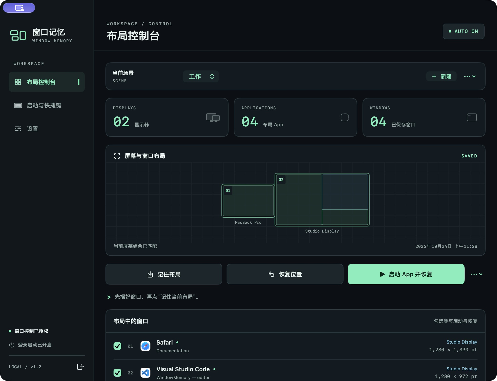
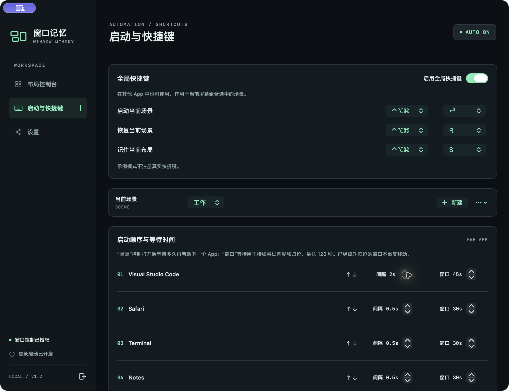
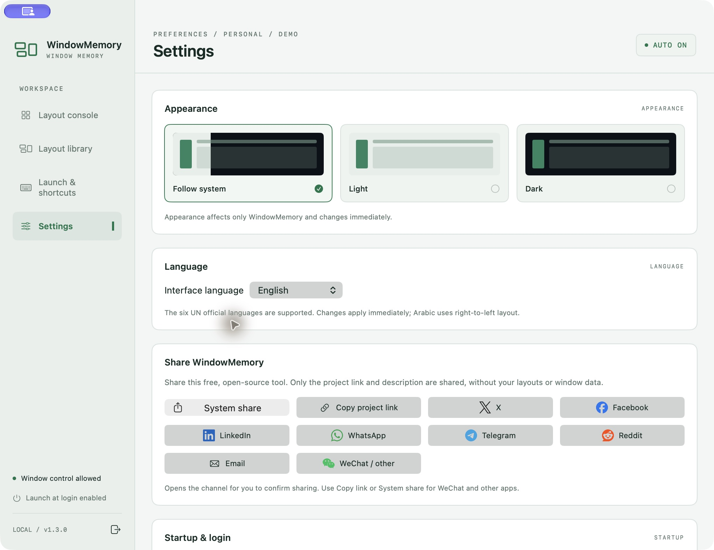
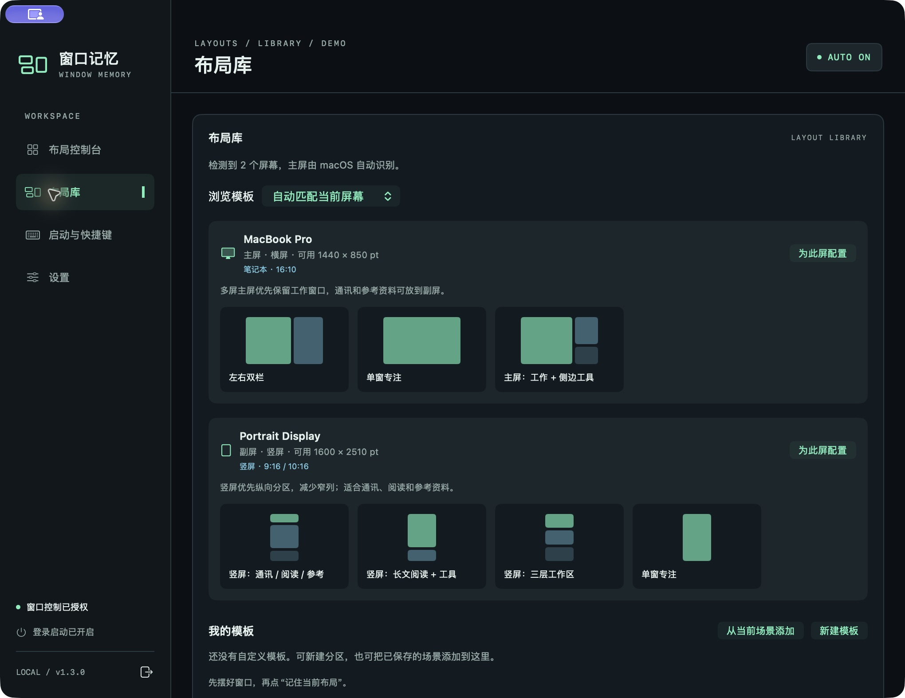
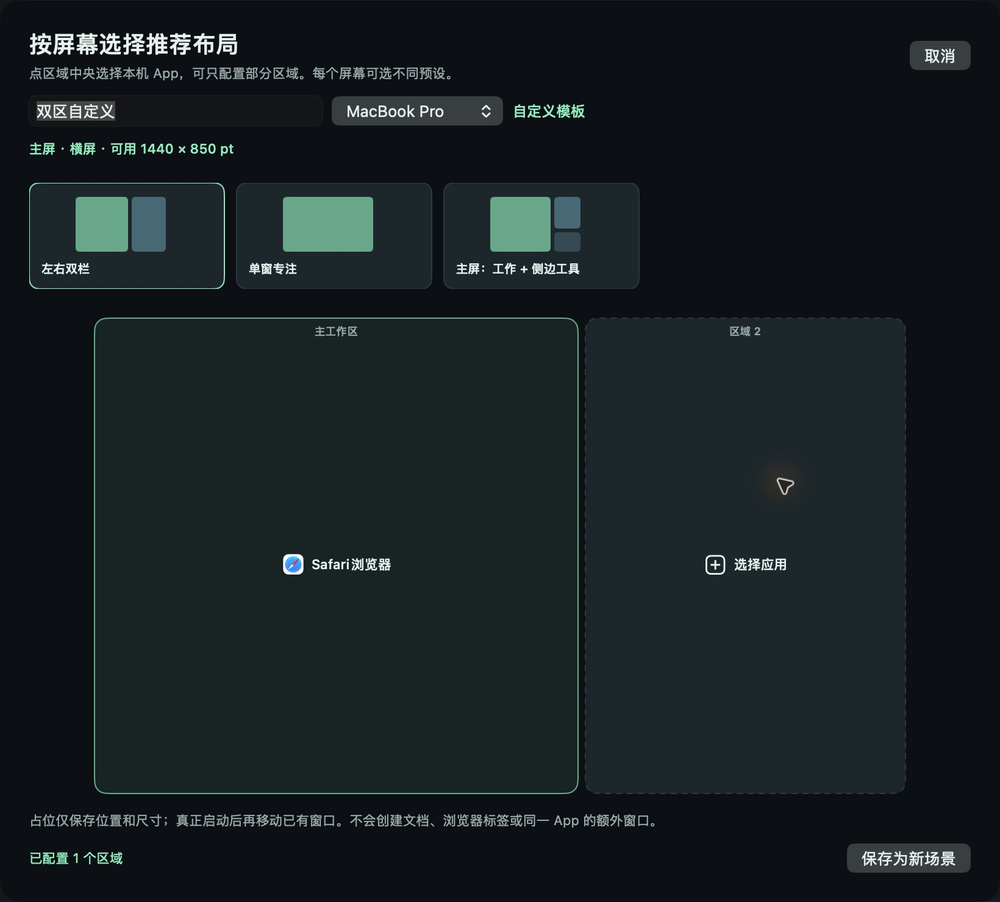

# WindowMemory · 窗口记忆

[](https://github.com/LZQVicLi/WindowMemory/releases/latest)
[](https://github.com/LZQVicLi/WindowMemory/actions/workflows/ci.yml)
[](LICENSE)


**摆好一次，把整个工作区带回来。** 原生 Swift 菜单栏工具，记住每个 App 的显示器、位置和宽高；按工作、会议、专注等场景恢复。

[English](README.en.md) · **[下载最新版本](https://github.com/LZQVicLi/WindowMemory/releases/latest)** · [使用说明](docs/USAGE.md) · [更新记录](CHANGELOG.md) · [签名与首次打开](docs/SIGNING.md)



*截图使用内置示例数据，不包含真实用户的窗口标题或布局。图片随代码托管在 GitHub，无需外部图床。*

## 功能

- **智能布局库**：根据当前屏幕数量、主副屏、横竖方向与可用尺寸自动推荐；可浏览七类主流屏幕、12 种分区模板。逐屏选择本机 App 显示占位，可留空，保存后直接进入现有场景流程。
- **我的模板**：自己设置区域位置与宽高，或将已有场景按屏幕加入库中；支持编辑、删除与复用。布局库为左侧一级入口，与设置平级。
- **多屏、多场景**：每套屏幕组合可保存多个具名布局，并分别记住当前场景。
- **一键启动与恢复**：按场景清单打开勾选的 App，同一软件只启动一个实例，再等待窗口归位。
- **启动编排**：每个 App 可调整顺序、打开后的间隔，以及最长 120 秒的窗口等待时间。
- **全局快捷键**：在其他软件中直接启动、恢复或保存当前场景，可修改组合并检测注册冲突。
- **布局导入导出**：JSON 备份；跨 Mac 导入时可选择屏幕映射；新增导入不覆盖旧场景。
- **自动归位**：App 启动、新窗口出现、屏幕连接变化、电脑唤醒时恢复，可独立开关。
- **登录启动**：可显示控制台或静默运行，也可选择登录时启动场景 App。
- **外观与语言**：跟随系统、浅色、深色立即切换；支持中文、英语、法语、西班牙语、俄语和阿拉伯语（从右到左布局）。
- **权限引导**：悬浮窗可拖动 App 图标到系统权限列表；返回 App 或等待时刷新授权状态。
- **分享项目**：对应渠道品牌图标；macOS 系统分享、复制链接、X、Facebook、LinkedIn、WhatsApp、Telegram、Reddit 和邮件；微信可复制链接。由用户确认发送，只传递公开项目链接与介绍。
- **菜单栏常驻**：可撤销上次手动恢复。









## 下载与安装

要求 **macOS 14 或更新版本**。1.2.0 起的下载包为 **Universal（Apple Silicon + Intel）**；历史 1.0/1.1 包为 Apple Silicon。

1. 在 [Releases](https://github.com/LZQVicLi/WindowMemory/releases) 下载对应版本的 `.dmg` 或 `.zip`。
2. 将「窗口记忆.app」放入「应用程序」。
3. 首次打开后，在系统设置中允许窗口控制权限（部分系统称为“辅助功能”或“设备控制和数据访问”）。
4. 打开常用 App、摆好窗口，点击 **记住布局**。随后可 **恢复位置** 或 **启动 App 并恢复**。

当前发布包使用 **ad-hoc 本地签名，未做 Apple Developer ID 公证**，下载后 macOS 可能阻止打开。可在检查来源后使用系统提供的“隐私与安全性 → 仍要打开”，或自行从源码构建。项目不要求关闭 Gatekeeper 或 SIP。重新编译更新后，如权限开关已开但程序仍显示未授权，需要移除旧授权记录，再添加安装路径中的新版。

每个 Release 保留带版本号的 ZIP、DMG（从 1.2.0 起）及 SHA-256 校验文件。将同一版本的下载包和校验文件放在同一目录，可运行：

```sh
shasum -a 256 -c SHA256SUMS.txt
```

## 默认快捷键

| 操作 | 默认组合 |
|---|---|
| 启动当前场景并恢复 | `⌃⌥⌘ Return` |
| 恢复当前场景 | `⌃⌥⌘ R` |
| 记住当前布局 | `⌃⌥⌘ S` |
| 打开设置（App 内） | `⌘ ,` |

全局快捷键在「启动与快捷键」中配置。App 必须正在运行；关闭主窗口后仍在菜单栏运行。选择场景不会立即移动窗口，可先检查再恢复。

## 数据与边界

布局、窗口标题、App 标识和设置保存在：

```text
~/Library/Application Support/WindowMemory/layouts.json
```

写入前保留上一版 `layouts.previous.json`。布局管理离线运行，无账号或遥测。主动点击分享时才通过浏览器或系统分享打开渠道，只带公开项目链接及介绍。导出的 JSON 包含窗口标题和软件清单，分享前请检查内容。导入文件只包含布局和启动配置，不会自动执行脚本、启动 App、注册登录项目或替换全局偏好设置。

- 普通、未最小化、非全屏窗口可参与恢复。其他 Spaces 的窗口访问受 macOS 限制。
- 相同 App 的多个窗口优先按标题匹配，标题相同或经常变化时可能互换。
- 不重建文档、项目、标签页，也不创建 App 未自行恢复的额外窗口。
- App 的最小尺寸或窗口控制限制可能导致恢复不完整，结果会在界面显示。
- 窗口自动恢复基于系统事件与有限重试，不会持续锁住你手动拖动的位置。

## 从源码构建

需要 Xcode 或兼容的命令行工具，无第三方 Swift 依赖。

```sh
git clone https://github.com/LZQVicLi/WindowMemory.git
cd WindowMemory
zsh build.sh
```

默认生成 `build/WindowMemory Preview.app`，使用独立的 Bundle ID 和合成演示数据，避免开发副本与已安装版本争用系统授权记录，也不会读写真实布局。默认同时构建 arm64 与 x86_64，并运行 **166 项自检**。可用 `ARCHS=arm64 zsh build.sh` 加速本机开发构建。

```sh
BUILD_MODE=release zsh build.sh  # build/窗口记忆.app，正式版本身份
zsh scripts/package.sh          # dist/：ZIP、DMG、SHA256SUMS.txt
```

正式包需要两种架构。不要同时运行开发目录里的正式包和 `/Applications` 中签名不同的同名版本；测试界面请使用默认 Preview 构建。权限开关开启仍未授权时，请参照[权限排查](docs/USAGE.md#窗口控制权限)。

[贡献指南](CONTRIBUTING.md) · [版本发布流程](docs/RELEASING.md) · [安全问题](SECURITY.md) · [后续计划](ROADMAP.md)

## 卸载

在设置中关闭登录启动，退出程序，再将 App 移到废纸篓。需要清除布局时，另行移除上面的数据文件夹。

## License

[MIT](LICENSE) © 2026 [LZQVicLi](https://github.com/LZQVicLi)

分享渠道品牌图标来自 [Simple Icons](Assets/ShareIcons/NOTICE.md)，遵循 CC0-1.0；相关商标属于各自所有者。
